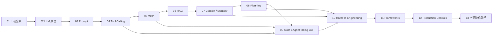

# AI Agent 工程课程路线

## 1. 课程目标

课程先分别讲透 AI Agent 的核心技术，再在综合实践中实现产研协作助手。

第 1 至 12 章的主要任务是学习。每章选择最适合当前技术的案例，不要求连续实现同一个产品。第 13 章负责组合 Prompt、Tool Calling、MCP、RAG、Memory、Planning、Skills、Agent-facing CLI、Harness、框架和生产控制，交付完整产研协作助手。

## 2. 教学主线

每个技术章节按照以下顺序展开：

```text
结论与学习目标
-> 技术背景与产生原因
-> 统一术语
-> 参与者及职责
-> 完整数据流和时序
-> 原理拆解
-> 渐进代码实验
-> 真实调用或完整实验
-> 工程边界
-> 与最终项目的关系
```

代码负责验证和观察原理。读者不阅读代码，也应能够解释技术为什么存在、数据如何流动、各参与者负责什么以及哪里容易失败。

## 3. 案例原则

1. 当前技术决定案例，最终项目不反向绑架前置章节。
2. 案例优先满足直观、短小、输入输出明显和容易制造边界条件。
3. 一个案例只承担有限的教学目标。
4. 复杂工程封装放在原理和最小实验之后。
5. 真实模型调用用于验证模型行为；固定响应用于验证本地控制代码。
6. 前置章节可在结尾说明该技术如何服务产研协作助手，篇幅保持克制。

## 4. 章节路线

| 章节 | 学习主题 | 主要学习结果 | 与最终项目的关系 |
| --- | --- | --- | --- |
| 01 | AI Agent 工程全景 | 建立技能地图和系统全景 | 认识 Capstone 的组成部分 |
| 02 | LLM 初识 | 理解 token、Attention、训练和生成 | 理解 Agent 的模型基础 |
| 03 | 面向产研协作助手 V0 的提示词工程 | 掌握指令、上下文、结构化输出和评测 | 用于项目输入输出协议 |
| 04 | Function Calling | 理解工具描述、模型选择、应用执行和结果回传 | 用于查询和操作业务系统 |
| 05 | MCP | 理解 Host、Client、Server、Tool、Resource 和 Prompt | 用于标准化连接外部能力 |
| 06 | RAG 知识库工程 | 理解 ingestion、chunk、embedding、检索、rerank 和引用 | 用于读取项目知识 |
| 07 | 上下文工程 | 理解短期上下文、压缩、状态和长期记忆 | 用于保存项目决策和未完成事项 |
| 08 | Agent Loop | 理解 plan-act-observe、状态机、重试和停止条件 | 用于执行多步骤协作任务 |
| 09 | Agent Skills 与 Agent-facing CLI | 理解可复用工作流、Agent 执行接口、认证授权和 Web/API 到 CLI 的改造 | 为项目提供稳定、可审计的业务操作面 |
| 10 | Agent Harness Engineering | 理解模型外部的运行环境、工具、权限、状态、恢复和反馈回路 | 为项目建立可靠的 Agent 运行时 |
| 11 | Agent Frameworks | 理解框架内核，并比较 PydanticAI、LangGraph、Microsoft Agent Framework | 为项目选择实现框架 |
| 12 | 生产控制 | 掌握评测、追踪、权限、注入防护和人审 | 为项目建立生产控制 |
| 13 | Capstone | 组合全部技术实现产研协作助手 | 完整项目交付 |
| 14 | 行业 Agent 落地 | 掌握行业选型、技术分工、数据闭环、风险分级和上线阶梯 | 独立扩展，不作为核心课程依赖 |

## 5. 第四章案例策略

第四章先使用一眼能看懂的确定性函数解释完整工具调用循环，再增加需要实时信息的查询工具。案例按照复杂度递增：

1. 加法器：观察模型如何选择函数和生成参数。
2. 天气查询模拟器：观察模型无法自行获得实时信息时如何请求工具。
3. 多工具请求：观察一轮多个 Tool Call 和各自的调用 ID。
4. DeepSeek 真实实验：观察真实模型的原始响应、工具执行和最终答复。

Registry、Dispatcher、错误协议、幂等和权限控制在读者理解基本时序后再出现。

## 6. 第九章大纲：Agent Skills 与 Agent-facing CLI

### 6.1 章节定位

本章分别讲清两个独立知识点，最后再讨论可选组合：

1. Skill：面向 Agent 的可复用工作流，包含触发描述、操作步骤、参考资料和可选脚本。
2. Agent-facing CLI：把 Web、桌面应用或业务 API 的能力整理为稳定、结构化、可授权、可审计的命令接口。

这里的 CLI 不承担 Linux 命令教学。重点是把原来给人点击的产品能力，改造成 Agent 可以发现、调用、验证和恢复的执行面。

### 6.2 核心问题

1. Skill、CLI、Tool Calling、MCP 和业务 API 分别负责什么。
2. Skill 从编写、校验、安装、发现、触发、加载、资源执行、Observation 回传到评测、分发和下线的完整生命周期。
3. Skill Script、Reference、Asset 与 Agent-facing CLI 分别负责什么。
4. Agent-facing CLI 如何设计命令语法、参数 Schema、JSON/NDJSON 输出、退出码、stderr、分页和版本兼容。
5. 如何处理 OAuth、访问令牌、服务账号、多账户、最小权限、凭证加密、令牌刷新和审计。
6. 如何把已有 Web/API 转成 CLI：能力盘点、命令建模、数据契约、授权、安全控制和契约评测。
7. 如何处理写操作的 dry-run、幂等键、确认门、速率限制、超时、重试和敏感数据。
8. Skill 与 CLI 在各自独立稳定后如何组合，组合后权限和可靠性仍由谁负责。

### 6.3 案例与实验

CLI 案例把团队日历 REST 服务改造成 `workcli`，并使用 Google Workspace CLI 作为行业对照。Skill 案例独立使用需求文档质量审查，包含 Script、Reference、Asset、Evals 和真实模型生命周期。

实验分为五步：

1. 观察同一能力的 Web 操作、REST 请求和 CLI 命令如何对应。
2. 从一个已有 REST 服务生成最小 Agent-facing CLI。
3. 独立编写需求审查 Skill，完成静态校验、发现和渐进披露。
4. 使用真实模型验证隐式触发、资源选择、Script Observation、最终输出和触发评测。
5. 比较 Skill、Skill Script、CLI 和 MCP 的职责，并说明 Skill + CLI 的可选组合。

主要调研基准：[OpenAI Build Skills](https://learn.chatgpt.com/docs/build-skills)、[Agent Skills 规范](https://agentskills.io/specification)、[Google Workspace CLI](https://github.com/googleworkspace/cli)。

## 7. 第十章大纲：Harness Engineering

### 7.1 章节定位

Harness 是模型外部的 Agent 运行系统。它负责把模型、指令、上下文、Skill、工具、执行环境、权限、状态和反馈回路组合起来，使 Agent 能够持续完成真实任务。

本章单独设置，不并入 Skill / CLI。Skill / CLI 解决“Agent 知道流程并能执行动作”，Harness 解决“整个 Agent 如何可靠运行”。

### 7.2 核心问题

1. What：Harness 的本质、产生背景、职责边界和七条生产不变量。
2. Integration：Harness 与模型、Agent Loop、框架、Skill、CLI、MCP、Memory 和 Guardrails 的关系。
3. How：上下文装配、模型决策、策略检查、工具执行、事件持久化和独立验收如何协作。
4. 工作目录、沙箱、网络、密钥、权限申请和审批如何管理。
5. Thread、Run、Turn、Item、Event、Checkpoint、幂等、重试、预算、取消和故障恢复如何设计。
6. 代码、文档、日志、指标、Artifact 和测试结果如何变成 Agent 可读信息。
7. When：直接模型调用、轻量循环、基础 Harness 和完整生产 Harness 分别适用哪些场景。
8. 自研与现成运行时、本地与远程、固定与动态工具、自治与人审如何取舍。

### 7.3 案例与实验

行业案例采用 OpenAI Codex harness engineering，分析 Agent 可读环境、仓库知识、工具、隔离运行、可观测性和反馈回路。

实验以跨文件 Python API 迁移任务为对象：

1. 运行裸 Agent Loop，观察模型提前宣布完成。
2. 加入 Context Builder、Artifact Store、Policy、Tool Runtime 和 Event Store。
3. 模拟工具完成但事件未落盘的崩溃窗口，使用稳定 `action_id` 和 Receipt Store 恢复。
4. 加入预算、超时、取消、Checkpoint 和独立 Verifier。
5. 使用 DeepSeek/OpenAI-compatible API 完成真实搜索、跨文件修改、测试和验收。

主要调研基准：[OpenAI Harness Engineering](https://openai.com/index/harness-engineering/)、[OpenAI Codex Agent Loop](https://openai.com/index/unrolling-the-codex-agent-loop/)。

## 8. 第十一章大纲：Agent Frameworks

### 8.1 章节定位

本章从控制权和状态归属解释 Agent Framework，再选择三个技术侧重点不同的框架完成同一实验：

1. PydanticAI：类型契约、依赖注入、工具与结构化输出。
2. LangGraph：显式 State、Node、Edge、Interrupt、Checkpoint 和恢复。
3. Microsoft Agent Framework：Agent、Executor、Workflow、人工请求和多 Agent 组合。

AutoGen 与 Semantic Kernel 按 Microsoft 官方后继路线放入 Microsoft Agent Framework 说明；OpenAI Agents SDK、Google ADK、Strands、LlamaIndex 和 CrewAI 参与分类与选型对照；Dify 和 Coze Studio 作为应用平台说明边界。

### 8.2 核心问题

1. Agent Framework 的编程模型、运行时和集成层分别负责什么。
2. 模型驱动、工作流驱动和混合控制如何取舍。
3. 多 Agent 何时产生真实收益，何时只增加调用次数。
4. 三个框架如何表达工具、类型化输出、状态、中断、恢复和事件。
5. OpenAI-compatible Provider 为什么需要按能力矩阵验证。
6. Checkpoint、框架重试、外部副作用、状态升级和多租户如何处理。
7. 如何通过统一 PoC、故障注入、升级回放、延迟和成本数据完成生产选型。

### 8.3 案例与实验

统一案例采用“共享测试环境部署申请”。Agent 读取 PR、CI 和环境证据，执行测试部署准入；
数据库迁移等待 Team Leader 批准，批准后只创建状态为 `queued` 的测试任务。CI/CD Runner
负责真正部署。Agent 不合并代码、不直接登录服务器，也不持有生产凭据。

教学实验全部使用本地模拟器，不要求配置 GitLab、Jenkins、Kubernetes 或审批系统：

1. 使用内存仓库模拟 PR API、CI API、环境注册表、审批响应和测试部署队列。
2. 使用确定性准入函数验证 CI 失败、Commit 不一致、环境占用和数据库迁移审批。
3. 使用稳定幂等键验证重复调用只创建一条测试任务。
4. 使用 PydanticAI `TestModel` 和 DeepSeek 验证工具轨迹与类型化输出。
5. 使用 LangGraph 验证 Interrupt、Resume、State History、拒绝分支和幂等入队。
6. 使用 Microsoft Agent Framework 验证类型化人工请求、Executor、Workflow 和 Agent 串联。
7. 统一比较原生轨迹、状态位置、Provider 兼容、恢复语义和生产成本。

## 9. 最终项目：产研协作助手

服务对象：产品经理、研发工程师和测试工程师。

最终项目处理以下任务：

1. 读取需求、技术方案、测试计划和项目记录。
2. 提取目标、范围、验收标准、风险和待确认问题。
3. 查询研发任务、缺陷、测试结果和发布状态。
4. 生成任务拆分、测试建议、风险清单和发布摘要草稿。
5. 保存已确认的项目决策、团队偏好和未完成事项。
6. 对多步骤任务制定计划并根据结果继续执行。
7. 在写入任务系统、发送通知和修改状态前请求人工确认。

第 13 章再定义完整业务对象、工具语义、状态、评测数据和输出协议。前置章节不承担产品迭代任务。

## 10. Learning Graph



## 11. 课程终点

读者完成课程后获得两类成果：

1. 对每项 Agent 核心技术的独立理解和可运行实验。
2. 一个组合全部技术的产研协作助手 Capstone。
